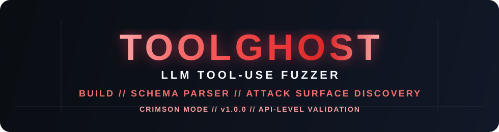

<div align="center">
  
</div>

<div align="center">
    <strong>LLM Agent function-calling schema fuzzer and tool-use validation probe.</strong>

<h2>Researcher: dontaskmehow<h2>


  Detects malformed tool arguments, unexpected parameter acceptance, and tool execution edge cases before they become exploit paths.
</div>

<p align="center">
  <a href="#quick-start"></a>
  <a href="#installation"></a>
  <a href="#usage"></a>
  <a href="#license"></a>
</p>

ToolGhost is a lightweight security-oriented testing utility for LLM tool-calling systems. It parses tool schemas, enumerates callable parameters, and submits malformed or adversarial values to a target URL to identify weak validation paths, dangerous tool behavior, and parameter smuggling patterns.

This project is designed for security research, red-team testing, and defensive validation of agent tool interfaces that accept structured tool calls.

## Why it exists

Large language model agents often invoke functions with structured arguments generated from JSON schemas. If those arguments are not constrained carefully, a tool may accept unexpected values, fail unpredictably, or expose downstream execution risks.

ToolGhost helps answer a practical question:

> Does this agent’s tool layer validate inputs before execution, or does it silently accept malformed payloads?

## At a glance

- Parses OpenAI/Anthropic-style tool schemas
- Extracts tool names and parameter definitions
- Sends fuzzed payloads against a target endpoint
- Identifies abnormal responses and validation gaps
- Produces terminal and JSON reports
- Works as a Python CLI for local or pipeline-based testing

## Key capabilities

- Schema-driven tool discovery
- Parameter mutation across common primitive types
- Adversarial payload generation for strings, numbers, and booleans
- Basic detection for abnormal HTTP responses and output signatures
- Terminal reporting with Rich tables
- JSON export for downstream automation

## How it works

ToolGhost loads a JSON schema file, extracts each tool parameter, and tests a short set of intentionally malformed values against a target agent endpoint.

```text
Schema file
   ↓
SchemaParser.extract_parameters()
   ↓
ToolGhostEngine.run()
   ↓
POST malformed tool payloads
   ↓
Collect status codes + response snippets
   ↓
Flag suspicious behavior
   ↓
JSON / terminal report
```

## Installation

```bash
git clone https://github.com/dntaskmehow/toolghost.git
cd toolghost
python -m pip install -e .
```

## Quick start

```bash
toolghost --url "http://localhost:8000/agent/tool-call" \
  --schema ./schema.json \
  --output toolghost_report.json
```

A minimal schema file looks like this:

```json
{
  "tools": [
    {
      "type": "function",
      "function": {
        "name": "execute_query",
        "parameters": {
          "type": "object",
          "properties": {
            "sql": {
              "type": "string",
              "description": "SQL query string"
            }
          },
          "required": ["sql"]
        }
      }
    }
  ]
}
```

## Usage

```bash
toolghost --help
```

Example with custom headers:

```bash
toolghost \
  --url "https://example.com/agent/tool" \
  --schema ./tool_schema.json \
  --header "Authorization: Bearer token" \
  --header "X-Trace-Id: abc123" \
  --output findings.json
```

## What ToolGhost checks

ToolGhost is intentionally focused on observable behavior instead of claiming broad security guarantees. It helps identify cases where:

- a parameter accepts malformed values without validation
- a tool returns unexpected success from malformed input
- server-side error states are exposed
- output includes sensitive execution signatures

This is useful for understanding and testing tool interfaces that are reachable from an LLM orchestration layer.

## Security and responsible use

ToolGhost is a research and assessment utility. Use it only against systems you own, are authorized to test, or have explicit permission to evaluate.

- do not target third-party systems without approval
- do not automate scanning against external services without consent
- treat outputs as evidence for a deeper review, not proof of a vulnerability by itself

## Project structure

```text
toolghost/
├── src/toolghost/
│   ├── __init__.py
│   ├── cli.py
│   ├── config.py
│   ├── engine.py
│   ├── reporter.py
│   └── schema_parser.py
├── tests/
│   └── test_toolghost.py
├── pyproject.toml
├── README.md
└── docs/
    └── assets/
        └── toolghost-neon-banner.svg
```

## License

This project is distributed under the MIT license.

## Contributing

Contributions are welcome. The goal is to keep the project small, focused, and useful for security-oriented LLM tool validation.

If you are improving schema parsing, payload generation, reporting, or CLI ergonomics, open a clean pull request with a focused explanation of the change and the validation used.

---

<p align="center">
  <small>ToolGhost — schema-driven LLM tool validation for security research and defensive testing.</small>
</p>
```

And the SVG banner to save as `docs/assets/toolghost-neon-banner.svg`:

```svg name=toolghost-neon-banner.svg
<svg width="980" height="260" viewBox="0 0 980 260" fill="none" xmlns="http://www.w3.org/2000/svg">
  <defs>
    <linearGradient id="bg" x1="0" x2="980" y1="0" y2="260" gradientUnits="userSpaceOnUse">
      <stop stop-color="#0A0D12"/>
      <stop offset="1" stop-color="#111827"/>
    </linearGradient>
    <filter id="neonGlow" x="-20%" y="-20%" width="140%" height="160%">
      <feDropShadow dx="0" dy="0" stdDeviation="4" flood-color="#F43F5E" flood-opacity="0.9"/>
      <feDropShadow dx="0" dy="0" stdDeviation="12" flood-color="#F43F5E" flood-opacity="0.55"/>
    </filter>
    <linearGradient id="crimson" x1="0" x2="1" y1="0" y2="0">
      <stop offset="0" stop-color="#FCA5A5"/>
      <stop offset="0.2" stop-color="#F87171"/>
      <stop offset="0.5" stop-color="#EF4444"/>
      <stop offset="0.8" stop-color="#DC2626"/>
      <stop offset="1" stop-color="#FCA5A5"/>
    </linearGradient>
  </defs>

  <rect width="980" height="260" rx="20" fill="url(#bg)"/>

  <g opacity="0.32">
    <path d="M30 210H950" stroke="#374151" stroke-width="1.5"/>
    <path d="M120 40V220" stroke="#374151" stroke-width="1.5"/>
    <path d="M860 40V220" stroke="#374151" stroke-width="1.5"/>
  </g>

  <g fill="url(#crimson)" filter="url(#neonGlow)">
    <text x="490" y="118" text-anchor="middle" font-family="Segoe UI, Arial, sans-serif" font-size="72" font-weight="800" letter-spacing="7">TOOLGHOST</text>
  </g>

  <g>
    <text x="490" y="155" text-anchor="middle" fill="#F8FAFC" font-family="Segoe UI, Arial, sans-serif" font-size="22" font-weight="600" letter-spacing="5">LLM TOOL-USE FUZZER</text>
    <text x="490" y="190" text-anchor="middle" fill="#F87171" font-family="Segoe UI, Arial, sans-serif" font-size="18" font-weight="700" letter-spacing="3">BUILD // SCHEMA PARSER // ATTACK SURFACE DISCOVERY</text>
    <text x="490" y="220" text-anchor="middle" fill="#FCA5A5" font-family="Segoe UI, Arial, sans-serif" font-size="14" font-weight="600" letter-spacing="2">CRIMSON MODE // v1.0.0 // API-LEVEL VALIDATION</text>
  </g>
</svg>
```
